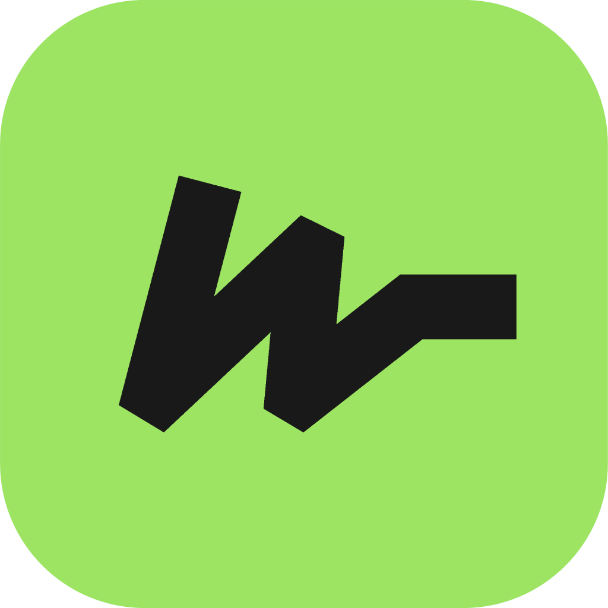
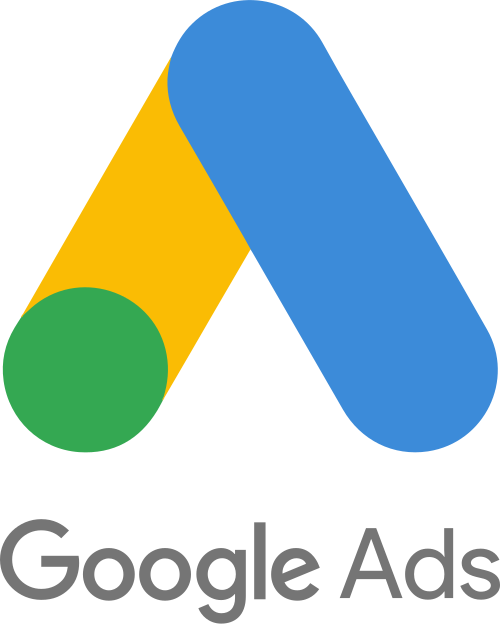
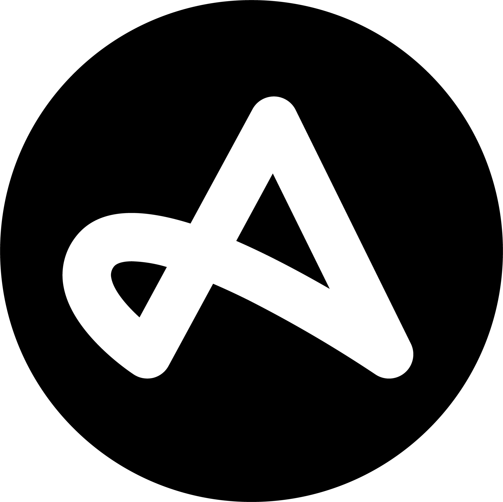

<div align="center">



# Whathead MCP

**Run your entire paid-media stack from your AI client.**

Connect Claude, ChatGPT, Cursor, or any MCP client to Whathead and manage campaigns,
creatives, audiences, reporting, and server-side conversions across every major ad
platform — in plain language, with a safety rail on every write.

[](https://github.com/SHAHINOOOO/whathead-mcp/actions/workflows/validate.yml)
[](https://modelcontextprotocol.io)
[](https://modelcontextprotocol.io)
[](./SECURITY.md)
[](./docs/safety.md)
[](https://whathead.com)

[**Connect now**](#-install-for-your-ai-client) · [Platforms](./docs/platforms.md) · [Tools](./docs/tools.md) · [Safety](./docs/safety.md) · [Pricing](#-pricing)

<br />

<sub>Works with</sub><br />
&nbsp;&nbsp;
&nbsp;&nbsp;
&nbsp;&nbsp;
&nbsp;&nbsp;


</div>

---

## What this does

Whathead is a hosted **Model Context Protocol** server. You connect it once to your AI
client and get a typed, permissioned interface to the real marketing APIs of every
platform you advertise on — no scripts, no CSV exports, no switching tabs.

Ask your assistant to:

- *"Audit wasted spend on the Meta account this month and pause the worst 3 ad sets."*
- *"Clone my top Google Search campaign into a Performance Max campaign, keep it paused."*
- *"Build a TikTok Smart+ campaign from these 4 videos and preview it before launch."*
- *"Transfer this Meta campaign to Snapchat, resize the assets to vertical."*
- *"Set up Meta CAPI for this pixel and route `Purchase` events server-side."*
- *"Pull a 30-day cross-platform performance report into Google Sheets."*

Every read is live. Every **write starts as a dry run** and destructive actions require
an explicit confirm. Nothing goes live without you saying yes.

## Supported platforms

**20+ integrations** spanning advertising, analytics, attribution, e-commerce, CRM, and
server-side conversions — with **1,400+ native ad-platform API endpoints** exposed across
the deepest five.

<div align="center">
&nbsp;&nbsp;&nbsp;
&nbsp;&nbsp;&nbsp;
&nbsp;&nbsp;&nbsp;
&nbsp;&nbsp;&nbsp;
&nbsp;&nbsp;&nbsp;
&nbsp;&nbsp;&nbsp;
&nbsp;&nbsp;&nbsp;
&nbsp;&nbsp;&nbsp;
&nbsp;&nbsp;&nbsp;

<br /><br />
&nbsp;&nbsp;&nbsp;
&nbsp;&nbsp;&nbsp;
&nbsp;&nbsp;&nbsp;

</div>

| Category | Platforms |
|---|---|
| **Ads (native, deep)** | Meta (Facebook + Instagram) · Google Ads · TikTok · Snapchat · Amazon Ads · Apple Search Ads |
| **Ads** | X (Twitter) · LinkedIn · Reddit · Criteo Retail Media · Display & Video 360 |
| **Analytics** | Google Analytics 4 · Google Search Console · Google Business Profile |
| **Tag & tracking** | Google Tag Manager · Signal (server-side CAPI) |
| **Attribution** | Adjust |
| **E-commerce** | WooCommerce · Shopify · Salla |
| **CRM** | Zoho CRM |

> Native depth per platform (real API endpoints reachable): **Meta 528 · TikTok 377 ·
> Snapchat 312 · Amazon 184 · Apple Search Ads 73.** Core operations are exposed as
> first-class tools; the full long tail is reachable through one typed dispatcher per
> platform, so your tool list stays clean.

See the full breakdown in **[docs/platforms.md](./docs/platforms.md)**.

## Why Whathead

- **Depth, not just breadth.** Near-complete native coverage of the Meta, Google, TikTok,
  Snapchat, Amazon, and Apple Search Ads APIs — not a thin read-only wrapper.
- **Cross-Platform Transfer.** Migrate a full campaign tree from one platform to another —
  entities mapped, media re-uploaded, assets resized — in a single instruction.
- **Signal — a built-in CDP.** Server-side Conversions API for Meta/Snap/TikTok plus lead
  capture and routing to your CRM. Close the loop from ad click to conversion to CRM record.
- **Preflight validation.** Before any launch, Whathead validates your campaign tree against
  each platform's objective, budget, creative, and asset rules and tells you what's missing.
- **Safe by construction.** `dry_run` on by default, `confirmed` required for destructive
  writes, OAuth 2.1 + PKCE, per-scope permissions, and full audit logging.
- **Works everywhere.** Claude, ChatGPT, Cursor, Codex, Windsurf, Gemini, Antigravity, n8n,
  Manus — any MCP-compliant client.

## See it in action

```text
You:  List my connected accounts, then show the 5 worst-CPA ad sets on Meta this week.

Whathead:  Connected: Meta (Naqi Ads, USD), Google Ads, TikTok, Snapchat…
           Top 5 ad sets by CPA (last 7 days, Meta / Naqi):
           1. "Retargeting – Broad"   CPA $41.20   spend $612   ↑ freq 6.1  ⚠ fatigue
           2. …

You:  Pause #1 and #2.

Whathead:  Dry run — will set 2 ad sets to PAUSED. Confirm to apply?

You:  confirm

Whathead:  ✅ Paused "Retargeting – Broad" and "Lookalike 3%". Audit logged.
```

## 🔌 Install for your AI client

The server is remote and hosted — there is nothing to run locally. Point your client at:

```
https://whathead.com/mcp
```

Your client walks you through a one-time OAuth login. Pick your client below:

| Client | One-liner |
|---|---|
| **Claude Code** | `claude mcp add --transport http whathead https://whathead.com/mcp` |
| **Claude Desktop / Web** | Settings → Connectors → Add → paste `https://whathead.com/mcp` — [guide](./docs/clients/claude-desktop.md) |
| **ChatGPT** (Pro/Business/Enterprise) | Settings → Connectors → Add custom connector → `https://whathead.com/mcp` — [guide](./docs/clients/chatgpt.md) |
| **Cursor** | Add to `.cursor/mcp.json` — [guide](./docs/clients/cursor.md) |
| **Codex CLI** | Add to `~/.codex/config.toml` — [guide](./docs/clients/codex-cli.md) |
| **Windsurf** | Add to `mcp_config.json` — [guide](./docs/clients/windsurf.md) |
| **Gemini CLI** | `gemini extensions install` — [guide](./docs/clients/gemini-cli.md) |
| **n8n / Manus / other** | Connector token — [guide](./docs/clients/n8n.md) |

Full walkthrough for every client: **[CONNECTING.md](./CONNECTING.md)**.

The ready-to-copy MCP config lives in [`.mcp.json`](./.mcp.json), and the server manifest
in [`server.json`](./server.json).

## What you get

- **Discovery** — list accounts, assets (pages, pixels, catalogs, apps), and workspace context.
- **Campaign lifecycle** — create / read / update / pause / publish campaigns, ad sets, and
  ads across every platform, with immutable-field guards.
- **Native platform tools** — the real, documented endpoints for Meta, Google, TikTok,
  Snapchat, Amazon, and Apple Search Ads.
- **Creative & media** — upload media, browse libraries, generate AI creatives, and preview
  ads before they publish.
- **Audiences & targeting** — custom audiences, lookalikes, interest/keyword lookup, size
  estimation.
- **Reporting** — live cross-platform performance reports, async report tasks, and export to
  CSV or Google Sheets.
- **Signal (CDP)** — server-side CAPI setup, event validation, delivery attempts, quality,
  and lead routing to Zoho CRM.
- **Cross-Platform Transfer** — one-shot campaign migration between platforms.

Browse the tool catalog in **[docs/tools.md](./docs/tools.md)**.

## Skills & slash commands

Ready-to-use [skills](./skills) and [slash commands](./commands) for the most common jobs —
drop them into `~/.claude/skills/` or `~/.claude/commands/` and go:

| Job | Skill | Command |
|---|---|---|
| Cut wasted spend | [`audit-wasted-spend`](./skills/audit-wasted-spend/SKILL.md) | `/wh-audit` |
| Weekly report | [`weekly-report`](./skills/weekly-report/SKILL.md) | `/wh-report` |
| Safe campaign launch | [`launch-campaign-safely`](./skills/launch-campaign-safely/SKILL.md) | `/wh-launch` |
| Server-side conversions | [`setup-server-side-tracking`](./skills/setup-server-side-tracking/SKILL.md) | `/wh-capi` |

## Trust & security

- **OAuth 2.1 with PKCE.** No API keys pasted into your client; tokens are scoped and rotate.
- **Least privilege.** Every tool declares a scope (`read:campaigns`, `write:campaigns`, …);
  connector tokens can be locked to specific tools, platforms, and accounts.
- **Human-in-the-loop writes.** `dry_run` is the default; destructive actions require
  `confirmed: true`.
- **Encrypted credentials.** Platform tokens are stored encrypted server-side and never
  returned to the client.
- **Full audit trail.** Every tool call is traced and logged.

Details and disclosure policy: **[SECURITY.md](./SECURITY.md)**.

## How it works

```text
  Your AI client  ──HTTPS + OAuth──▶  Whathead MCP  ──▶  Whathead backend  ──▶  Ad platform APIs
   (Claude, etc.)                     (this service)      (tokens, throttle,     (Meta, Google,
                                                           normalization)         TikTok, …)
```

The MCP layer validates and shapes your request, then hands it to the Whathead backend,
which owns credentials, rate-limiting, and platform-error normalization. **The MCP server
never calls an ad-platform API directly** — a clean, auditable boundary.

## Use cases

- **Agencies** managing dozens of accounts across platforms from one chat.
- **In-house teams** running audits, launches, and weekly reporting without leaving Claude.
- **RevOps** wiring server-side conversions and CRM lead routing with Signal.
- **Automation** — schedule reports and ops via n8n / Manus using connector tokens.

## 💳 Pricing

| Plan | Price | For |
|---|---|---|
| **Starter** | **$29 / mo** | Solo operators and single-brand accounts. |
| **Growth** | **$79 / mo** | Agencies and multi-account, multi-platform teams. |

See current plans and limits at **[whathead.com/pricing](https://whathead.com/pricing)**.

## Contributing

This repository holds the public connection docs, client configs, and skills for the
Whathead MCP service. Issues and PRs that improve the docs or add client guides are welcome —
see **[CONTRIBUTING.md](./CONTRIBUTING.md)**. For the hosted service itself, reach us via
support below.

## Support

- 🌐 [whathead.com](https://whathead.com)
- 📩 [support@whathead.com](mailto:support@whathead.com)
- 🐛 [Open an issue](https://github.com/SHAHINOOOO/whathead-mcp/issues)

## License

See [LICENSE](./LICENSE). The configuration snippets and documentation here are free to use
to connect to Whathead. The Whathead name, service, and backend are proprietary.
